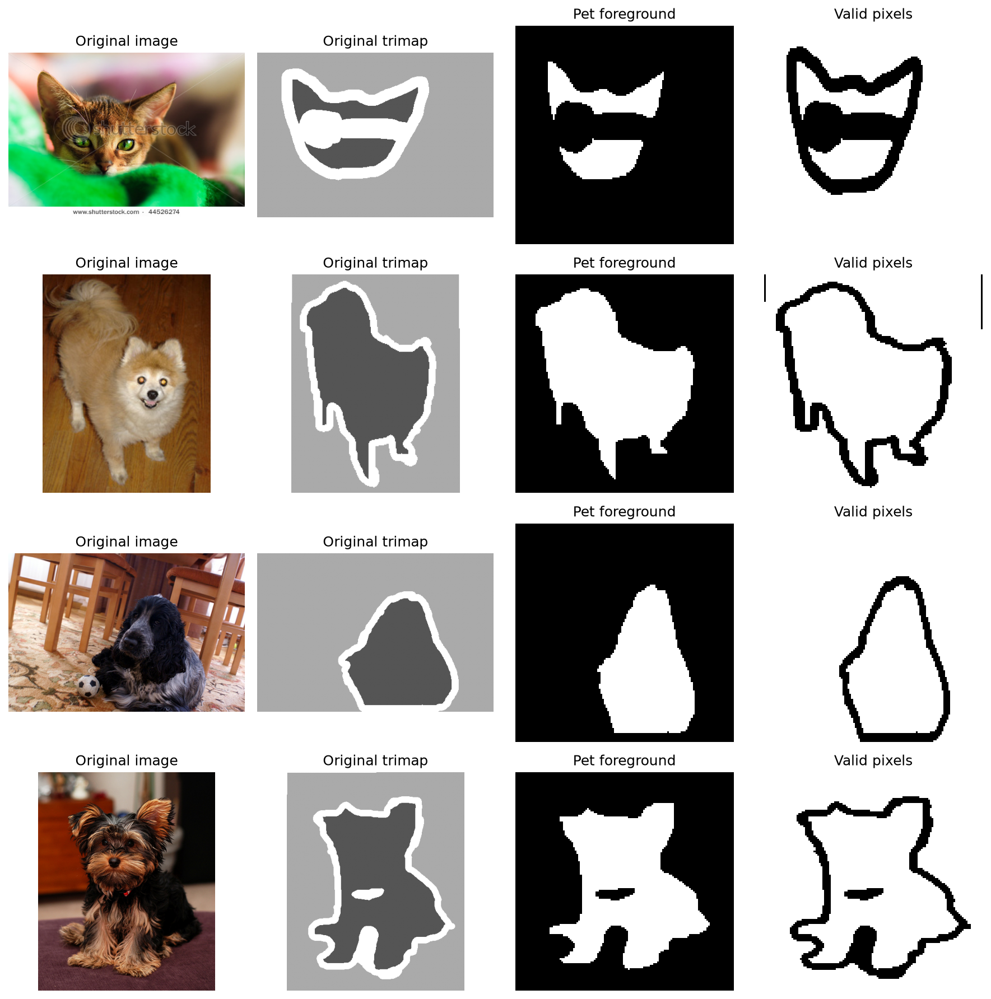
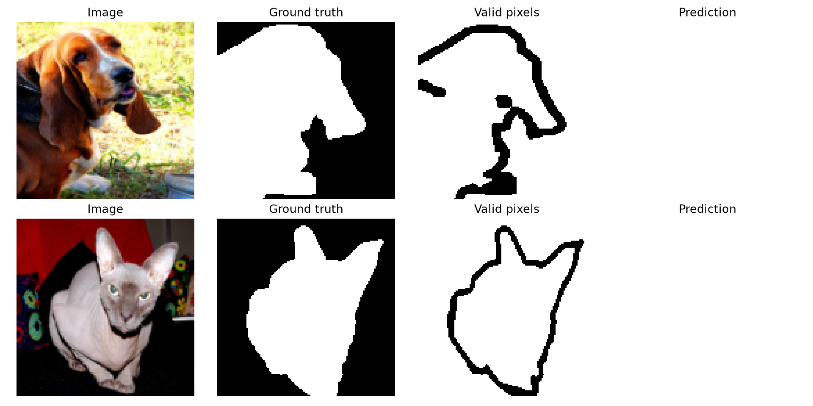

# Phase 1 Technical Report — Draft for Student Review

**DSAI 403: Nature-Inspired Computation · Project 08 · Zewail City of Science, Technology and Innovation**

**Instructor:** Assoc. Prof. Mohamed Maher Ata

**Prepared:** 30 October 2026
**Status:** Implementation draft. Experimental entries must be populated only from completed runs.

> **Source and submission note.** The course file `NIC_Project8_PSO_UNet_Arabic_English.pdf` was not present in the supplied project workspace. This draft follows the attached project brief and the cited primary literature. The student team must compare the document against the official course handout, verify every claim and result, revise the prose in their own voice, and check the course rules for AI-assisted work before submission.

## 1. Project Title

**Particle Swarm Optimization of U-Net Hyperparameters for Pet Image Segmentation.** This Phase 1 project implements a reproducible binary semantic segmentation experiment using a compact U-Net, the Oxford-IIIT Pet dataset, and Particle Swarm Optimization (PSO). It evaluates a fixed-hyperparameter baseline against an 8-epoch U-Net trained from scratch with hyperparameters selected by a short PSO pilot. It is an implementation and evaluation of established techniques on a selected dataset, not a claim of a new optimization algorithm.

## 2. Problem Definition

Given an RGB photograph containing a cat or dog, binary semantic segmentation assigns each pixel either pet foreground or non-pet background. This differs from breed classification: the output is a spatial mask rather than one label for the whole photograph. Segmenting pets is difficult because backgrounds may be cluttered, contours are irregular, fur creates thin structures, lighting and object scale vary, and some foreground colors resemble the background. Under a limited compute budget, network training is also sensitive to learning rate, regularization, and the number of candidate experiments that can be afforded.

The research question is: **Can Particle Swarm Optimization select U-Net hyperparameters that improve pet image segmentation performance relative to a fixed baseline while maintaining a practical computational budget?** Improvement is not presumed. A meaningful comparison requires the same data split, preprocessing, loss, metric policy, random-seed policy, final training epochs, and checkpoint-selection rule. The additional PSO search cost must be reported separately from final model training time.

The primary quality measures are mean foreground Dice coefficient and mean foreground intersection-over-union (IoU). Secondary measures are baseline runtime, PSO search time, and final training time. The final held-out test set should be used once the training protocol and hyperparameters are fixed; all model selection uses validation data only.

## 3. Dataset Description

The [Oxford-IIIT Pet dataset](https://www.robots.ox.ac.uk/~vgg/data/pets/) contains photographs across 37 cat and dog breeds with pixel-level trimap annotations [3]. The selected protocol uses 7,349 images: the official 3,680-image development split is divided with seed 42 into 2,944 training and 736 validation members, while all 3,669 official test images are held out. The implementation uses `torchvision.datasets.OxfordIIITPet(..., target_types="segmentation")` and writes exact split memberships to `splits/train.txt`, `splits/validation.txt`, and `splits/test.txt` when data preparation executes. It checks pairing and split non-overlap before training.

Each input image is resized to 128 × 128 pixels with bilinear interpolation and converted to three-channel float values in `[0, 1]`. Each trimap is resized with nearest-neighbor interpolation to preserve integer labels. Label `1` maps to foreground `1`; label `2` maps to background `0`; label `3` is excluded via an explicit valid-pixel mask. A horizontal flip with probability 0.5 is applied jointly to image, binary target, and valid mask only for training. Validation and test transformations are deterministic. The target and valid mask are kept separate so ignored pixels do not influence the loss or reported metrics.

The official dataset page states that the image and annotation archives total roughly 800 MB and that images vary in scale, pose, and lighting. It also specifies the dataset license and retains the original image owners' copyright. The downloaded archives and unpacked data therefore stay outside Git. The Oxford host timed out on the local machine, so the exact archives were obtained from a [mirror](https://huggingface.co/datasets/Shiym/ViT-FineTune/tree/main/oxford-iiit-pet), with MD5 values `5c4f3ee8e5d25df40f4fd59a7f44e54c` (images) and `95a8c909bbe2e81eed6a22bccdf3f68f` (annotations) matching Torchvision's official checksums. Preparation then verified all three expected split counts and zero overlap.



## 4. Literature Review

Kennedy and Eberhart [1] introduced particle swarm optimization as a continuous-function optimizer motivated by social behavior. Particle positions evolve using velocity, individual best, and swarm best information. Their work established the search idea, but did not study modern convolutional segmentation or prove that this project's small swarm will improve validation quality. Ronneberger, Fischer, and Brox [2] introduced U-Net's contracting path for context and symmetric expanding path for localization, with skip connections and augmentation. Their original application was biomedical segmentation; this project adapts the architecture at lower width and resolution for pet photographs.

Parkhi and colleagues [3] introduced the pet dataset for fine-grained breed recognition, including trimap segmentation annotations. The approximately 59% breed-classification accuracy reported by the original paper concerns a different task and is not a segmentation baseline. Saifullah and Dreżewski [4] reported PSO tuning of learning rate and dropout for a modified U-Net on brain-tumor MRI; the publisher abstract reports improvements of up to four percentage points in Dice and two in Jaccard over the comparisons it describes. Their 2025 PSO-UNet paper [5] reports tuning filters, kernel size, and learning rate for multimodal MRI segmentation, with abstract-reported Dice values of 0.9578 and 0.9523 on its stated datasets. These domain-specific results motivate the approach but do not predict pet-segmentation performance.

| Source | Research problem and method | Optimized parameters / verified finding | Limitation and relevance here |
|---|---|---|---|
| Kennedy & Eberhart (1995) [1] | Continuous nonlinear optimization with a particle swarm; benchmark tests and prospective neural-network uses. | Established particle-based search. The present inertia and coefficient settings are project pilot choices, not claimed optimal values from [1]. | No U-Net or pet segmentation; supplies the NIC foundation. |
| Ronneberger et al. (2015) [2] | Dense biomedical segmentation with a contracting and symmetric expanding convolutional network and data augmentation. | Source reports strong performance on its biomedical challenge; no PSO tuning. | Different imaging domain and network scale; supplies the encoder-decoder design. |
| Parkhi et al. (2012) [3] | Fine-grained cat/dog breed classification and dataset creation. | 37 breeds; images include trimap masks; reported breed accuracy is about 59%, not segmentation Dice. | Provides the selected dataset, not a directly comparable segmentation result. |
| Saifullah & Dreżewski (2024) [4] | Brain-tumor MRI segmentation with modified U-Net and PSO before training. | Tunes learning rate and dropout; publisher abstract reports up to +4 percentage points Dice and +2 Jaccard in its comparisons. | Medical domain and different protocol; supports the tuning hypothesis only. Full chapter is subscription content. |
| Saifullah & Dreżewski (2025) [5] | Multimodal brain-tumor segmentation with PSO-UNet. | Tunes filter count, kernel size, and learning rate; arXiv abstract reports Dice 0.9578 and 0.9523 on BraTS 2021 and Figshare. | Different search space, architecture, data, and compute; no score transfer to pets. |

The literature provides architecture and search precedents. The present work tests a more constrained search over learning rate, bottleneck dropout, and weight decay. The strongest inferential risk is treating validation improvements found by search as evidence of generalization without a final held-out test comparison and repeat seeds.

## 5. Selected NIC Algorithms

PSO is the selected Nature-Inspired Computation method. Each particle represents three continuous training hyperparameters:

```text
x = [log10(learning_rate), dropout, log10(weight_decay)]
learning_rate in [0.0001, 0.003]
dropout in [0.0, 0.3]
weight_decay in [0.000001, 0.001]
```

Logarithmic coordinates give multiplicative parameters more balanced exploration. At each round, a candidate initializes a **fresh** U-Net, trains on the training split for two epochs, and returns mean validation Dice. The minimized objective is `fitness(x) = 1 − validation_Dice(x)`. The official test set never enters this objective.

For particle `i`, dimension `d`, and iteration `t`, the selected update is:

```text
v[i,d,t+1] = w*v[i,d,t]
             + c1*r1*(pbest[i,d] - x[i,d,t])
             + c2*r2*(gbest[d] - x[i,d,t])
x[i,d,t+1] = clip(x[i,d,t] + v[i,d,t+1], lower[d], upper[d])
```

The pilot defaults are `w = 0.7`, `c1 = 1.5`, `c2 = 1.5`, seed 42, three particles, and two evaluation rounds **including initialization**. Thus a complete pilot has six candidate fitness evaluations and a total of twelve candidate-training epochs. This is a limited search, not evidence of a globally optimal configuration. Candidate quality and total search time are logged per run; a fresh final U-Net is then trained for eight epochs to match the baseline final budget. Search time is a separate cost.

## 6. Selected AI/Deep Learning Model

The compact U-Net consumes `(B, 3, 128, 128)` tensors. Four encoder double-convolution blocks use 16, 32, 64, and 128 output channels, with max pooling between levels. A 256-channel double-convolution bottleneck contains the only configurable dropout. The decoder upsamples and concatenates same-scale encoder features through skip connections, then applies double-convolution blocks with 128, 64, 32, and 16 output channels. A final `1 × 1` convolution returns `(B, 1, 128, 128)` **logits**. No pretrained weights are used. Dropout placement stays identical for the baseline and PSO candidates; only its probability changes.

For each image, binary cross-entropy with logits is averaged over valid pixels only. Soft Dice uses only valid-pixel probabilities and labels. The common loss is `0.5 × masked BCE + 0.5 × masked soft Dice`. An image with zero valid pixels is excluded from the batch average. A whole batch with zero valid pixels does not trigger an optimizer update. The same implementation and numerical weights are used in both experiment branches.

At inference, sigmoid converts logits to probabilities, which are thresholded at 0.5. For each image, only valid pixels contribute to true positives (`TP`), false positives (`FP`), and false negatives (`FN`):

```text
Dice = 2*TP / (2*TP + FP + FN)
IoU  = TP / (TP + FP + FN)
```

If both prediction and truth contain no foreground, both scores equal 1. Images with no valid pixels are excluded. Reported metrics are arithmetic means of the remaining image scores, not global pooled-pixel ratios. This policy avoids a large image or background region dominating the evaluation and is identical for all models.

## 7. Proposed Architecture/Pipeline

The system has a shared data path and two training branches. The shared path downloads or reuses the Oxford-IIIT Pet files, verifies image/mask pairing, creates fixed memberships, and returns image, target, and valid-mask tensors. The baseline branch trains one U-Net with the fixed configuration. The PSO branch evaluates six two-epoch candidates, updates particle bests, exports the best parameter vector, and trains a fresh eight-epoch final U-Net. Both branches select the checkpoint with highest validation Dice. Final evaluation loads each selected checkpoint and computes held-out test Dice and IoU without further tuning.

The editable diagrams are [`overall_pipeline.mmd`](../figures/architecture/overall_pipeline.mmd), [`unet_architecture.mmd`](../figures/architecture/unet_architecture.mmd), [`pso_flow.mmd`](../figures/architecture/pso_flow.mmd), and [`preprocessing_pipeline.mmd`](../figures/architecture/preprocessing_pipeline.mmd). They specify the overall experiment, model geometry, optimizer feedback, and trimap preprocessing. They are methodology diagrams; any plotted performance figures must come from real completed training.

## 8. Initial Implementation

The codebase separates configuration, dataset and preprocessing, U-Net, losses, metrics, common training and evaluation, PSO, visualization, and command-line scripts. `config.json` contains the selected Phase 1 defaults. `python -m scripts.prepare_dataset` prepares local data and split files; `python -m scripts.train_baseline` runs the fixed training protocol; `python -m scripts.run_pso` performs the pilot and final retraining; `python -m scripts.evaluate_models` requires both finalized checkpoints before opening the held-out test split; and `python -m scripts.generate_results` prepares measured result views. The Colab notebook calls these shared entry points rather than maintaining a second training implementation.

The CPU test suite uses synthetic images and masks so ordinary CI does not download the roughly 800 MB dataset or run a full experiment. Tests cover trimap conversion, deterministic splits, model shape and gradients, ignored-pixel loss behavior, empty-valid batches, metric corner cases, PSO bounds and best updates, protocol guards, and a small training integration loop. **Forty local pytest tests passed** on Python 3.11.9 with PyTorch 2.5.1+cpu. The GitHub Actions workflow targets Python 3.11 on a CPU runner; its outcome remains unverified until a remote run completes. A synthetic baseline smoke run and synthetic PSO integration run each completed one small epoch, without being counted as Oxford results.

Reproducibility depends on fixed split IDs, a recorded seed, the executed configuration, compute device, completed epoch count, runtime, and saved history. Checkpoints and downloaded data remain local; histories, small figures, and metadata can be committed if real and reasonably sized. The missing course PDF remains a documentation blocker pending student review.

## 9. Baseline Model

The selected baseline is the compact U-Net described above with AdamW, learning rate `0.001`, weight decay `0.0001`, bottleneck dropout `0.10`, batch size `16`, image size `128 × 128`, seed `42`, and eight epochs. The loss weights are `0.5` for masked BCE and `0.5` for masked soft Dice. After each epoch, the model is evaluated on the validation split; the checkpoint with highest mean validation Dice is saved. Training loss, validation loss, validation Dice, validation foreground IoU, actual epochs, and elapsed training time are recorded by the run. The best checkpoint is selected from validation, not test, performance.

| Parameter | Baseline value | PSO final-model rule |
|---|---:|---|
| U-Net widths | 16 / 32 / 64 / 128; bottleneck 256 | Identical architecture |
| Image size / batch size | 128 × 128 / 16 | Identical |
| Optimizer | AdamW | AdamW |
| Learning rate | 0.001 | PSO-selected within bounds |
| Bottleneck dropout | 0.10 | PSO-selected within bounds |
| Weight decay | 0.0001 | PSO-selected within bounds |
| Loss | 0.5 masked BCE + 0.5 masked Dice | Identical |
| Final epochs / seed | 8 / 42 | 8 / 42 |
| Checkpoint selection | Best validation Dice | Best validation Dice |

The PSO pilot itself trains each candidate for two epochs and uses validation Dice only as a search signal. It must not be put into a comparison table against the eight-epoch baseline as if both were final trained models.

## 10. Initial Experimental Results

The following table is populated only by completed run artifacts. A missing value is **pending**, not a zero score. Runtime values refer to elapsed wall-clock measurements; PSO search time is additional to final-model training time. The preliminary row used **64 seeded training and 32 seeded validation images for one epoch** and is not comparable to the required full baseline or PSO final model. See `reports/RUN_STATUS.md` for verified outcomes and blockers.

| Model | Split | Completed epochs | Mean Dice | Mean foreground IoU | Training time | Search time |
|---|---|---:|---:|---:|---:|---:|
| Preliminary subset U-Net | Validation subset (32) | 1 | 0.5150 | 0.3681 | 9.06 s | Not applicable |
| Fixed baseline U-Net | Validation | Pending | Pending | Pending | Pending | Not applicable |
| PSO-selected final U-Net | Validation | Pending | Pending | Pending | Pending | Pending |
| Fixed baseline U-Net | Held-out test | Pending | Pending | Pending | Report with run | Not applicable |
| PSO-selected final U-Net | Held-out test | Pending | Pending | Pending | Report with run | Report with run |

The preliminary run recorded training loss `0.6679` and validation loss `0.6503` in `results/preliminary_history.csv`. In the displayed validation examples, the one-epoch model predicts nearly every pixel as foreground. Its nonzero Dice reflects foreground overlap, not useful boundary delineation. This observation underscores why the small subset check is only a pipeline verification and cannot answer the research question.



The full analysis should inspect loss and validation-Dice curves for training instability or overfitting, compare the selected validation checkpoints, then evaluate each final model once on the held-out test split. If PSO improves validation Dice but not test Dice, that would indicate selection noise or overfitting to validation, especially with six evaluations and one seed. If PSO improves test Dice, the magnitude must be interpreted with its search cost and run-to-run variance. These are interpretation rules, not observed findings.

**Limitations and next steps.** The pilot's three particles and two rounds search only a small portion of the space; two-epoch fitness may poorly rank eight-epoch outcomes. A single seed does not measure uncertainty. The 128-pixel input may lose fine fur boundaries. Subsequent work should complete both final training runs, evaluate test data only after selection, repeat across seeds, report mean and spread, inspect qualitative failures, and compare quality gain per unit search time.

**AI-assistance disclosure draft for student review:** “An AI coding assistant helped draft implementation code, tests, diagrams, notebook text, and this report. The student authors reviewed the code, verified cited sources and executed results, corrected errors, and take responsibility for the submitted work.” This text is a suggested disclosure only. The team must adapt it to its actual contribution and the official course academic-integrity policy.

## References

[1] Kennedy, J., & Eberhart, R. (1995). “Particle swarm optimization.” *Proceedings of ICNN'95*, 1942–1948. https://doi.org/10.1109/ICNN.1995.488968. Original paper consulted via an author-hosted [PDF](https://staff.washington.edu/paymana/swarm/kennedy95-ijcnn.pdf).

[2] Ronneberger, O., Fischer, P., & Brox, T. (2015). “U-Net: Convolutional Networks for Biomedical Image Segmentation.” https://arxiv.org/abs/1505.04597.

[3] Parkhi, O. M., Vedaldi, A., Zisserman, A., & Jawahar, C. V. (2012). “Cats and Dogs.” *IEEE Conference on Computer Vision and Pattern Recognition*. https://www.robots.ox.ac.uk/~vgg/publications/2012/parkhi12a/ and https://www.robots.ox.ac.uk/~vgg/data/pets/.

[4] Saifullah, S., & Dreżewski, R. (2024). “Automatic Brain Tumor Segmentation Using Convolutional Neural Networks: U-Net Framework with PSO-Tuned Hyperparameters.” *Parallel Problem Solving from Nature – PPSN XVIII*, 333–351. https://doi.org/10.1007/978-3-031-70071-2_21. Results summarized from the publisher abstract.

[5] Saifullah, S., & Dreżewski, R. (2025). “PSO-UNet: Particle Swarm-Optimized U-Net Framework for Precise Multimodal Brain Tumor Segmentation.” *GECCO '25 Companion*. https://arxiv.org/abs/2503.19152. Results summarized from the arXiv abstract.
